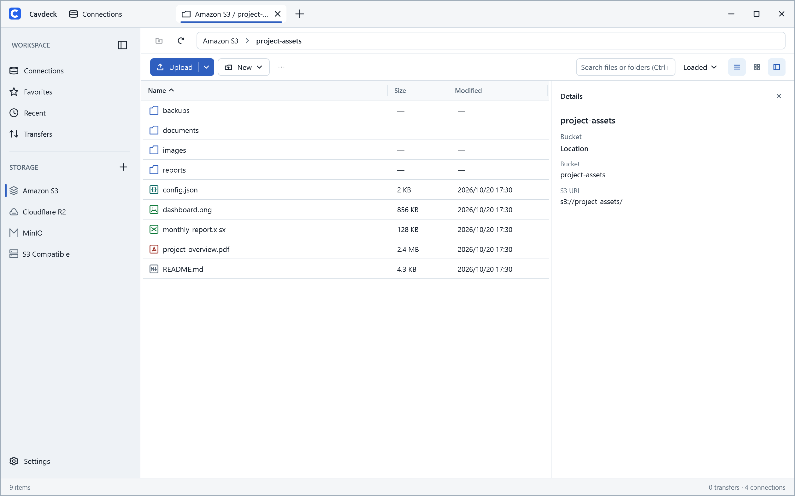
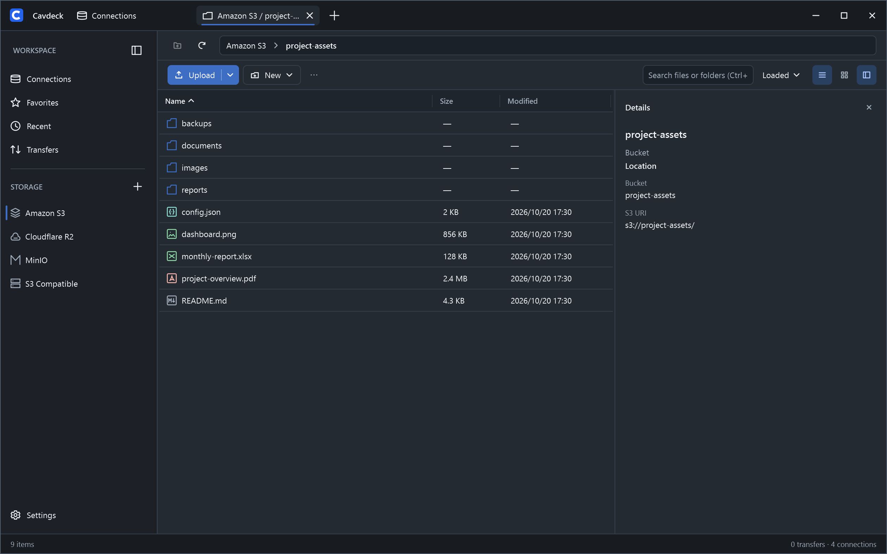
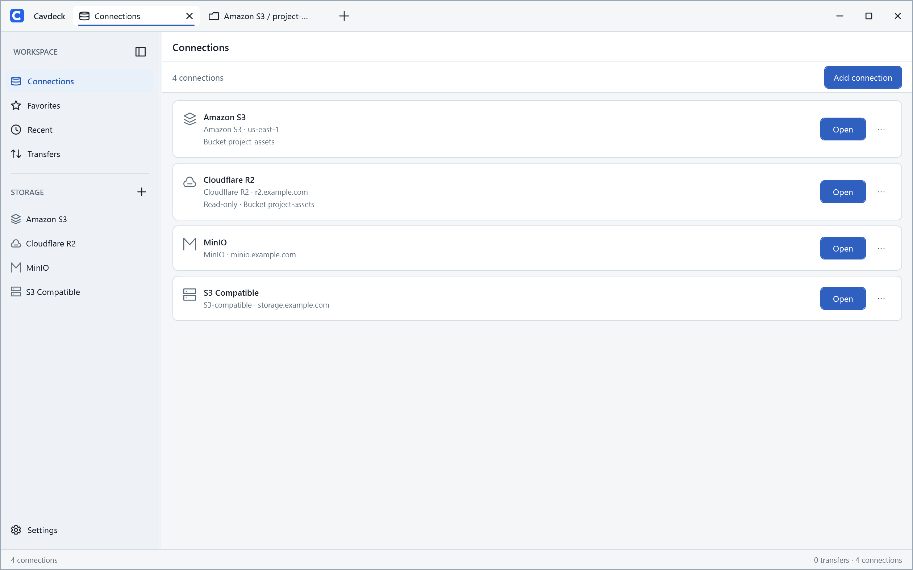
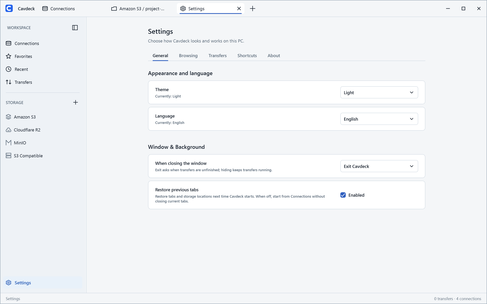

<p align="center">
  
</p>

<h1 align="center">Cavdeck</h1>

<p align="center">
  <strong>Your S3 storage, in a familiar Windows file manager.</strong>
</p>

<p align="center">
  A modern, free and open-source Windows desktop client for managing Amazon S3, Cloudflare R2, MinIO, and other S3-compatible storage.
</p>

<p align="center">
  <a href="#installation">Installation</a> ·
  <a href="#features">Features</a> ·
  <a href="#screenshots">Screenshots</a> ·
  <a href="#quick-start">Quick start</a> ·
  <a href="#building-from-source">Build</a> ·
  <a href="#contributing">Contribute</a>
</p>

<p align="center">
  
  
  <a href="LICENSE"></a>
  <a href="https://github.com/imnbwd/Cavdeck/actions/workflows/release.yml"></a>
</p>

Browse buckets, drag and drop files, manage transfers, and preview content without switching cloud consoles. Cavdeck connects directly to your storage providers—no Cavdeck account or subscription required.

[](assets/screenshots/explorer-light.png)

## Features

- **Connect to your storage.** Manage Amazon S3, Cloudflare R2, MinIO, and custom S3-compatible endpoints side by side. Save multiple connections, test credentials, and optionally limit access to a specific bucket or prefix.
- **Browse and organize.** Explore buckets with tabs and breadcrumbs, switch between detailed lists and icon views, and quickly find objects with sorting and search. Create folders or text files, rename objects, and remove items with confirmation.
- **Manage transfers.** Upload files or folders by dragging and dropping, and download individual objects or entire folders. Monitor concurrent transfers, including progress, pause, resume, retry, and failure details.
- **Copy and move files.** Use familiar clipboard shortcuts or **Copy to…** to work within or across connections and buckets. Choose **Skip**, **Keep Both**, or **Overwrite** for conflicts, and track cross-connection operations in **Transfers**.
- **Preview and edit.** Inspect supported text, images, and PDFs without first saving them manually. Edit text with overwrite safeguards, view object details, and create public or time-limited sharing links where supported.
- **Work with confidence.** Configure read-only access or restrict a connection to a bucket or key prefix. Review confirmations before destructive operations, with additional verification for cross-connection moves.
- **Quick access to your files.** Bookmark frequently used buckets and folders in **Favorites**, and revisit locations through **Recent**. Keep multiple storage locations open in tabs while you work.
- **Work your way.** Switch between light, dark, and system themes and choose English, Simplified Chinese, Japanese, or German. Customize everyday settings, use keyboard shortcuts, and optionally minimize to the system tray.

## Screenshots

<table>
  <tr>
    <th width="33%">Dark theme</th>
    <th width="33%">Connections</th>
    <th width="34%">Settings</th>
  </tr>
  <tr>
    <td>
      <a href="assets/screenshots/explorer-dark.png">
        
      </a>
    </td>
    <td>
      <a href="assets/screenshots/connections-light.png">
        
      </a>
    </td>
    <td>
      <a href="assets/screenshots/settings-light.png">
        
      </a>
    </td>
  </tr>
</table>

## Installation

**Windows x64:** Download releases from the official [GitHub Releases](https://github.com/imnbwd/Cavdeck/releases) page, or [build Cavdeck from source](#building-from-source). Release availability depends on what has been published to that page.

When available, choose:

- **`Cavdeck-<version>-Setup.exe`** — recommended installer.
- **`Cavdeck-<version>.msi`** — alternative with per-user or per-machine installation.

Windows 11 is the primary testing target. The GitHub installers are unsigned, so Windows may show an *Unknown Publisher* or SmartScreen warning. Download only from the official Releases page and verify against the published SHA-256 checksums (`SHA256SUMS.txt`). PDF preview requires the Microsoft Edge WebView2 Runtime.

## Quick start

1. Open **Connections** and select Amazon S3, Cloudflare R2, MinIO, or a compatible endpoint.
2. Enter the required connection details and credentials, then **Test** and save.
3. Open a bucket to browse files, drag and drop uploads, or monitor progress in **Transfers**.

Use least-privilege credentials and read-only mode when you do not need to modify objects. If you cannot list buckets, specify the bucket and optional key prefix in the connection settings.

## Usage notes

### Browsing and file operations

- S3 folders are **object-key prefixes**, not real directories.
- Renaming, moving, or deleting a folder can affect many objects. Review the confirmation details before proceeding.
- Broader searches may require additional requests and continuation.

### Copying and moving across connections

- **Copy:** Press **Ctrl+C**, then **Ctrl+V**; use **Copy to…** to select a destination.
- **Move:** Press **Ctrl+X**, then **Ctrl+V**. Both copy and move can span connections and buckets.
- **Permissions:** Copies can start from read-only connections. Moves also require source-delete permission and write/verification access at the destination.
- **Name conflicts:** Choose **Skip**, **Keep Both**, or **Overwrite**. Overwriting always requires an explicit choice for that operation.
- **Transfer costs:** Cross-connection transfers pass through your computer and may incur provider transfer or request charges.
- **Metadata:** Copies preserve file bytes and `Content-Type`, but may not preserve other metadata, tags, or storage settings.
- **Move behavior:** A cross-connection move uses **copy, verify, then delete**; it is not an atomic rename. The source is deleted only after destination verification.
- **Recovery:** Interrupted or failed moves may need attention in **Transfers**. Provider support for conditional requests and verification varies, so Cavdeck may reject an operation rather than risk data loss.

### Previews, editing, and links

- **Preview:** Supported text files, images, and PDFs can be previewed in Cavdeck. PDF preview uses WebView2 and is subject to file-size limits.
- **Editing:** Text editing checks the remote version when supported and may request confirmation before overwriting.
- **Public links:** Object details can provide a public HTTPS link when a public bucket URL is configured.
- **Presigned links:** A time-limited download link may be available when supported by the provider. Creating a link does not change bucket permissions.
- **Link security:** **Treat presigned links as temporary access credentials** and share them only with intended recipients.
- **Scope:** Cavdeck is a file manager, not a directory synchronization tool.

## Windows CLI

Use the standalone cavdeck.exe to list objects, inspect metadata, and transfer files with saved connections. See the [CLI guide](docs/cli.md) for installation and commands.

## Building from source

Cavdeck is built with WPF and .NET 10. You need Windows and the [.NET 10 SDK](https://dotnet.microsoft.com/download/dotnet/10.0); Visual Studio with the .NET desktop development workload is optional.

From the repository root, run:

```powershell
dotnet restore Cavdeck.sln
dotnet build Cavdeck.sln -c Debug --no-restore
dotnet test Cavdeck.sln -c Debug --no-build
dotnet run --project src/Cavdeck.App/Cavdeck.App.csproj
```

See [CONTRIBUTING.md](CONTRIBUTING.md) for development conventions, testing, and release validation.

## Security and privacy

Cavdeck connects directly to your configured storage endpoints and stores credentials in **Windows Credential Manager**.

- **Local data:** Cavdeck keeps application data on your computer:
  - **Preferences, connections, favorites, and recent locations:** `%APPDATA%\Cavdeck\`
  - **Transfer history and recovery data:** `%LOCALAPPDATA%\CavdeckData\`
  - **Diagnostic logs:** `%LOCALAPPDATA%\CavdeckData\Logs\`. Preview-related temporary files may contain object names or paths; review them before sharing.
- **File operations:** Confirm destructive changes and use appropriate backups and least-privilege credentials. Provider permissions remain authoritative.
- **Updates:** Installed releases can check the official GitHub Releases feed automatically or on demand and optionally download updates in the background. Applying an update requires confirmation and is blocked while unfinished transfers remain. Builds run from source do not use this update flow.
- **Diagnostics:** Logs stay local unless you share them. Review logs and screenshots before reporting issues.

Do not include credentials, private object names, file contents, or presigned links in public reports. Report vulnerabilities privately as described in [SECURITY.md](SECURITY.md).

## Contributing

Bug reports, feature requests, and focused pull requests are welcome. Read [CONTRIBUTING.md](CONTRIBUTING.md) before submitting changes, use [GitHub Issues](https://github.com/imnbwd/Cavdeck/issues) for feedback, and follow [SECURITY.md](SECURITY.md) for vulnerability reports.

## License

Cavdeck is licensed under the **[GNU General Public License v3.0 or later](LICENSE)** (`GPL-3.0-or-later`). It is free to use, including commercially, subject to the license terms. Third-party components retain their own licenses; see [THIRD_PARTY_NOTICES.md](THIRD_PARTY_NOTICES.md).
